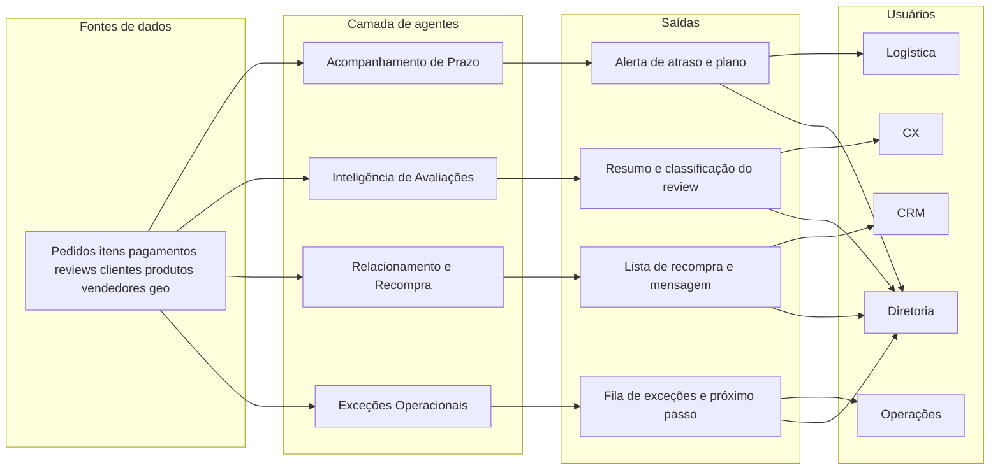

# Arquitetura conceitual inicial

Visão de **quem usa o quê e para quê**. Nesta fase, “arquitetura” significa: dado do caso → assistente com prompt → texto para um time → pessoa decide.

## Entradas e saídas

- **Acompanhamento de Prazo**  
  Entra: pedido, status, hoje (se ainda não entregue), datas (compra, transportadora se houver, entrega se houver, prazo estimado), UF, frete, vendedor.  
  Sai: risco (baixo/médio/alto), motivo, **uma** ação (`monitorar`, `avisar o cliente` ou `cobrar vendedor/transportadora`), texto ao cliente se for avisar, e se encaminha para Exceções.

- **Inteligência de Avaliações**  
  Entra: pedido, nota, título, comentário, status, se atrasou, categoria.  
  Sai: tema, urgência, resumo, rascunho de resposta, encaminhar (CX, Acompanhamento de Prazo, Exceções, qualidade/seller ou nenhum).

- **Relacionamento e Recompra**  
  Entra: código interno do caso (só operador), quantidade de pedidos, última compra, última nota, se atrasou, categoria, UF, se não quer contato.  
  Sai: prioridade de contato, mensagem (sem o código interno), categoria sugerida, o que **não** ofertar.

- **Exceções Operacionais**  
  Entra: pedido, status diferente de entregue, compra, prazo e hoje (quando o caso ainda tem prazo), valor pago, meio.  
  Sai: tipo, prioridade, próximo passo, texto interno; financeiro sempre recusado pelo agente.

## Interações entre agentes

- Avaliação com tema “atraso” chama o Acompanhamento de Prazo (mesmo pedido).
- Acompanhamento de Prazo com atraso grave ou pedido parado chama Exceções.
- Recompra **só** recebe quem teve entrega no prazo e nota 4–5 — CX e logística alimentam o filtro.
- Diretoria recebe um painel semanal: % atraso, nota, recompra e fila de exceções — não o texto de cada caso.

## O que esta arquitetura não é

Não há treino de modelo próprio nesta fase. Os agentes são **instruções + um caso da Olist + pessoa responsável**. O “sistema” é um chat e um CSV. Plataforma e orquestração ficam para as fases 3–4, se o negócio ainda fizer sentido.
