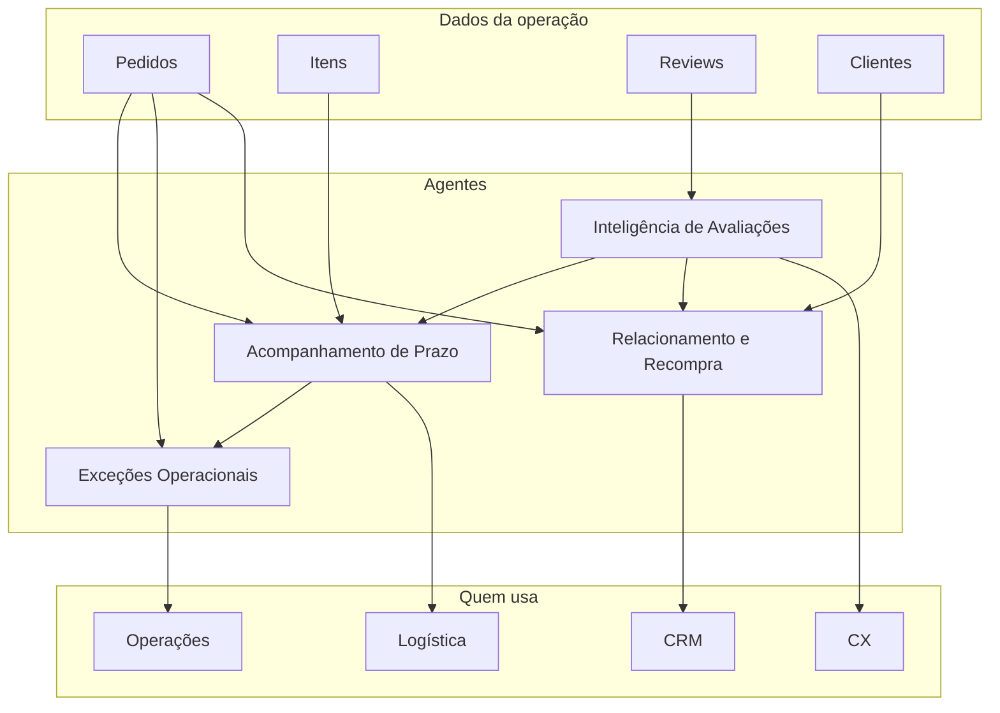

# Mapa de agentes de IA — Olist

Quatro agentes, cada um com dono de negócio claro. Eles não substituem times: **preparam a decisão** e o texto da ação. São assistentes de ofício (prazo, review, CRM, fila).

Instruções completas, no mesmo modelo de prompt, em [prompts_agentes.md](prompts_agentes.md).

## Fichas

### 1. Acompanhamento de Prazo

- **Objetivo:** Antecipar atraso e orientar o que fazer antes (e depois) da data prometida.
- **Problema:** Atraso é minoria, mas quebra a nota (2,57 vs 4,29).
- **Usuários:** Logística, sellers, atendimento.
- **Benefício:** Menos surpresa para o cliente; menos nota 1–2 ligada a prazo.
- **Riscos:** Alarme falso; vendedor não consegue cumprir o plano sugerido.

### 2. Inteligência de Avaliações

- **Objetivo:** Ler reviews (nota + texto), classificar a causa e sugerir resposta ou escalonamento.
- **Problema:** 15% de notas 1–2 e 41% de comentários não viram aprendizado nem ação padronizada.
- **Usuários:** CX, qualidade, marketplace (seller).
- **Benefício:** Tempo de resposta menor; padrão de tom; causa raiz visível (prazo, produto, entrega).
- **Riscos:** Classificação errada; resposta genérica em caso sensível (dano, fraude).

### 3. Relacionamento e Recompra

- **Objetivo:** Identificar quem tende a não voltar e sugerir o próximo contato (oferta, prazo, categoria).
- **Problema:** 96,9% dos clientes compram uma vez.
- **Usuários:** CRM, marketing, comercial do marketplace.
- **Benefício:** Aumentar segunda compra com foco em quem teve boa entrega e boa nota.
- **Riscos:** Oferta invasiva; campanha para quem teve má experiência (piora a marca).

### 4. Exceções Operacionais

- **Objetivo:** Agrupar pedidos cancelados, indisponíveis ou parados e redigir o próximo passo para o time.
- **Problema:** Poucos casos, alta dor (nota ~1,8 em cancelados) e fila manual.
- **Usuários:** Operações, atendimento, estoque/seller.
- **Benefício:** Fila priorizada; menos cliente “perdido” no status.
- **Riscos:** Automatizar estorno ou cancelamento sem regra humana.
