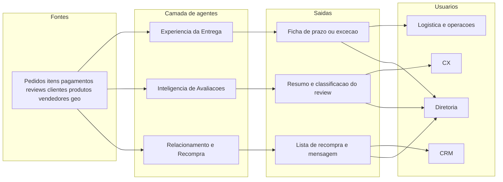

# Arquitetura conceitual — Fase 2

Visão de **quem usa o quê e para quê**. “Arquitetura” ainda significa: dado do caso → assistente com prompt → texto para um time → pessoa decide.

A diferença em relação à Fase 1: **três** agentes, **dois** programas, e a fila de exceção **dentro** da Experiência da Entrega.

## Entradas e saídas

- **Experiência da Entrega**  
  Entra: pedido, status, hoje (se ainda não entregue ou se parado), datas (compra, transportadora se houver, entrega se houver, prazo estimado), UF, frete, vendedor, valor pago e meio (úteis na trilha de exceção).  
  Sai: trilha (`prazo` ou `excecao`), risco ou prioridade, motivo, **uma** ação, texto ao cliente se for avisar, próximo passo interno se for exceção. Financeiro sempre recusado pelo agente.

- **Inteligência de Avaliações**  
  Entra: pedido, nota, título, comentário, status, se atrasou, categoria.  
  Sai: tema, urgência, resumo, rascunho de resposta, encaminhar (CX, Experiência da Entrega, qualidade/seller ou nenhum).

- **Relacionamento e Recompra**  
  Entra: código interno do caso (só operador), quantidade de pedidos, última compra, última nota, se atrasou, categoria, UF, se não quer contato.  
  Sai: prioridade de contato, mensagem (sem o código interno), categoria sugerida, o que **não** ofertar.

Dado externo opcional e honesto: **calendário de feriados** na trilha de prazo (não inventa CRM, estoque em tempo real nem NPS).

## Interações entre agentes

- Avaliação com tema “atraso” chama a Experiência da Entrega (mesmo pedido, trilha prazo).
- Avaliação de cancelado/indisponível chama a Experiência da Entrega (trilha exceção).
- Recompra **só** recebe quem teve entrega no prazo e nota 4–5 — CX e logística alimentam o filtro.
- Diretoria recebe um painel semanal: % atraso, nota, recompra e fila de exceções — não o texto de cada caso.

## O que esta arquitetura não é

Não há treino de modelo próprio nesta fase. Os agentes são **instruções + um caso da Olist + pessoa responsável**. Plataforma e orquestração ficam para as fases 3–4.
