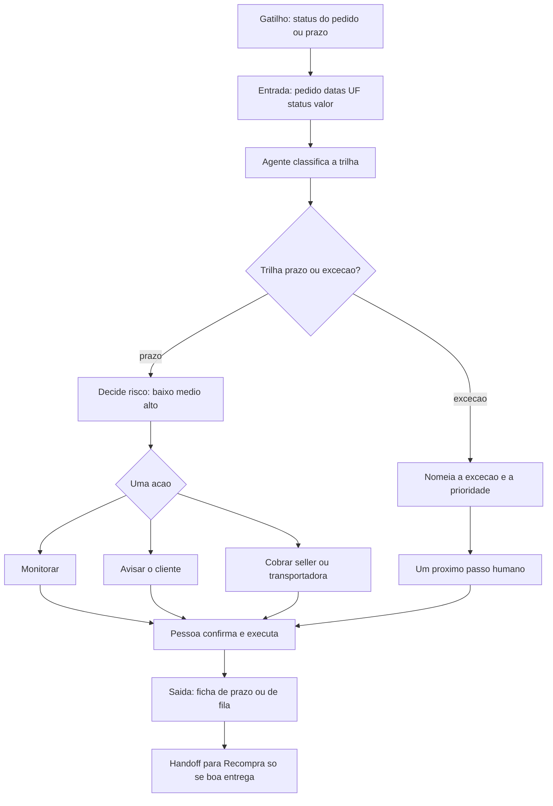
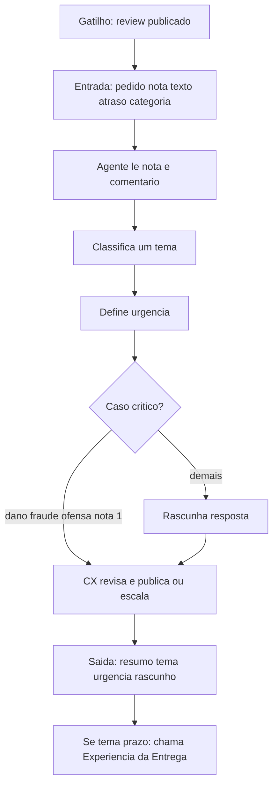
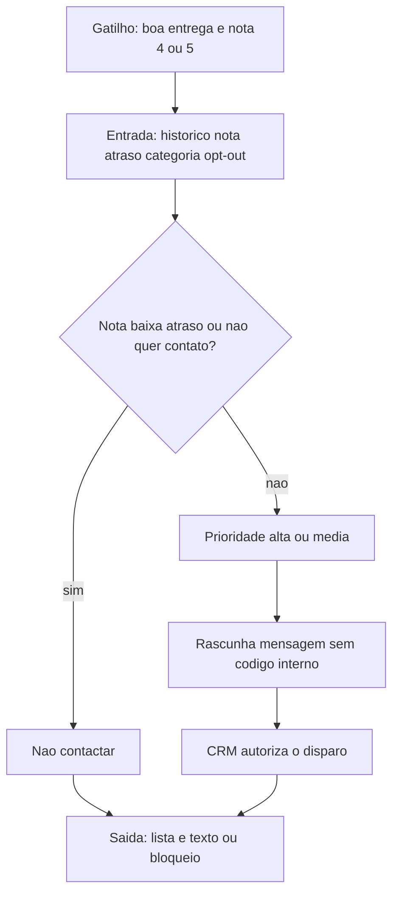

# Jornadas de funcionamento — Fase 2

Três fluxos simples. Em cada um: **gatilho**, **entrada**, **decisão**, **ação**, **humano**, **saída**. Pessoa no loop em toda execução que fale com cliente ou mexa em dinheiro.

Figuras usadas no relatório: [figuras/jornada_experiencia_entrega.png](figuras/jornada_experiencia_entrega.png), [figuras/jornada_avaliacoes.png](figuras/jornada_avaliacoes.png), [figuras/jornada_recompra.png](figuras/jornada_recompra.png).

## 1. Experiência da Entrega

Gatilho: pedido muda de status, o prazo se aproxima, ou CX encaminha review de atraso/cancelamento.

Humano: logística/ops autoriza o aviso e qualquer movimento financeiro. O agente **nunca** estorna.

## 2. Inteligência de Avaliações

Gatilho: cliente publica avaliação (nota, com ou sem texto).

Humano: CX publica a resposta. Caso crítico não sai rascunho automático para o cliente.

## 3. Relacionamento e Recompra

Gatilho: pedido entregue no prazo **e** última nota 4 ou 5 (filtro alimentado pelos outros dois agentes).

Humano: CRM decide se envia. Má experiência **nunca** entra na lista.
