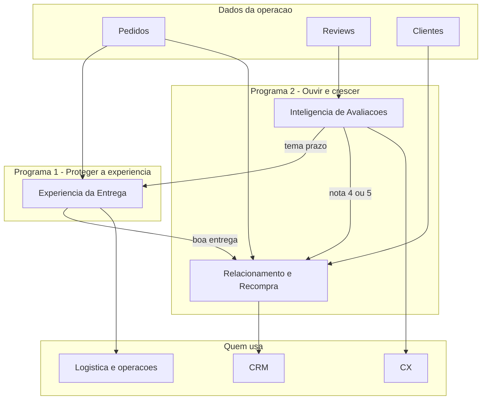

# Mapa de agentes de IA — Olist (Fase 2)

Três agentes, dois programas. Cada um tem dono de negócio claro. Eles não substituem times: **preparam a decisão** e o texto da ação.

Instruções completas em [prompts_agentes.md](prompts_agentes.md). Jornadas em [jornadas_agentes.md](jornadas_agentes.md).

A Fase 1 tinha quatro fichas. **Exceções Operacionais** entrou como trilha do agente **Experiência da Entrega** (mesmo pedido, logística/ops).

## Fichas

### 1. Experiência da Entrega

- **Objetivo:** Antecipar atraso **e** organizar pedido fora do fluxo feliz (cancelado, indisponível, parado), com uma próxima ação humana.
- **Problema:** Atraso é minoria, mas quebra a nota (2,57 vs 4,29). Cancelados saem com nota ~1,8. São a mesma jornada do pedido, não dois produtos.
- **Usuários:** logística, operações, sellers, atendimento; cliente só recebe texto se a ação for avisar.
- **Benefício:** menos surpresa; fila única de prazo + exceção; menos nota 1–2 ligada a cumprimento.
- **Riscos:** alarme falso; vendedor sem capacidade de reagir; interpretar a ficha como ordem de estorno.

### 2. Inteligência de Avaliações

- **Objetivo:** Ler reviews (nota + texto), classificar a causa e sugerir resposta ou escalonamento.
- **Problema:** 15% de notas 1–2 e 41% de comentários não viram aprendizado nem ação padronizada.
- **Usuários:** CX, qualidade, marketplace (seller).
- **Benefício:** tempo de resposta menor; padrão de tom; causa raiz visível (prazo, produto, entrega).
- **Riscos:** classificação errada; resposta genérica em caso sensível (dano, fraude).

### 3. Relacionamento e Recompra

- **Objetivo:** Identificar quem tende a não voltar e sugerir o próximo contato (oferta, prazo, categoria).
- **Problema:** 96,9% dos clientes compram uma vez.
- **Usuários:** CRM, marketing, comercial do marketplace.
- **Benefício:** aumentar segunda compra com foco em quem teve boa entrega e boa nota.
- **Riscos:** oferta invasiva; campanha para quem teve má experiência.

## O que não é agente nesta fase

- Frete isolado, ranking de sellers, mix de categorias.
- Exceções como quarto produto: viram **ramo** da Experiência da Entrega.
